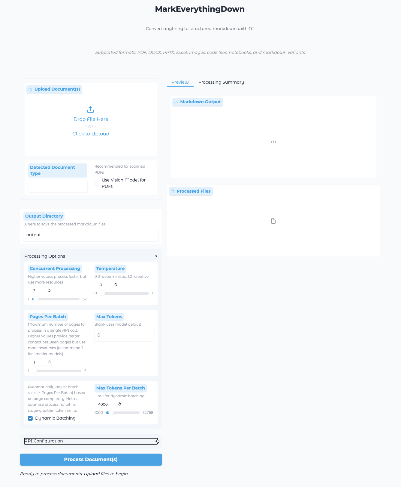

# MarkEverythingDown

通过视觉语言模型（VLM）的 API，将 PDF 文件转换为结构清晰、便于阅读和整理的 Markdown 文件。本分支主要用于学术论文转换，针对双栏论文的阅读顺序设置了明确的提示词规则。

> **项目用途**：把论文 PDF 整理为可编辑的 Markdown，方便阅读、记录笔记，以及后续交给大语言模型分析。
>
> **默认处理方式**：所有 PDF 默认开启视觉模式，将每页渲染为图片后调用 API，再按原页序合并为 Markdown。
>
> **双栏论文的处理规则**：要求模型先从上到下读取左栏，再读取右栏，避免混合不同栏的句子；分别保留标题、作者、摘要、正文、公式、表格、图注和参考文献等逻辑块。
>
> **效果边界**：这些版面规则由视觉模型执行，实际效果取决于所用模型和页面清晰度。复杂公式、表格和跨页内容仍建议抽查；本说明不代表已经完成真实论文转换的端到端验证。

## 使用方法：网页界面



### 在启动脚本中集中配置

编辑项目根目录的 `start.sh`，集中设置 API 密钥、服务地址、模型和 Conda 环境。当前脚本使用 Bash 语法，请通过 `bash start.sh` 启动，不要使用 `sh start.sh`。

现有脚本从 `DASHSCOPE_API_KEY` 读取密钥。如果希望所有配置都放在脚本中，可在 `set -euo pipefail` 后添加：

```bash
# 填写自己的 API 密钥；请勿将真实密钥提交到公开仓库。
export DASHSCOPE_API_KEY="替换为你的 API 密钥"
```

然后检查或修改脚本中已有的对应配置行，无须重复添加：

```bash
# API 密钥：供项目中的视觉模型处理器读取。
export QWEN_API_KEY="$DASHSCOPE_API_KEY"

# API 地址：需要支持兼容 OpenAI 的聊天接口及图片输入。
export QWEN_BASE_URL="https://dashscope.aliyuncs.com/compatible-mode/v1"

# 模型名称：填写服务端实际提供、且支持图片输入的模型。
export QWEN_MODEL="qwen3.7-flash-2026-07-15"

# Conda 环境：需要与下文创建的环境名称一致。
CONDA_ENV_NAME="${CONDA_ENV_NAME:-mark-everything-down}"

# Conda 初始化脚本：使用其他安装位置时修改此路径。
CONDA_SH="/home/krixdina/miniconda3/etc/profile.d/conda.sh"
```

> **配置说明**：上面的地址和模型名称来自当前 `start.sh`，不是对该模型可用性的保证。更换服务时，应同时检查 API 地址、密钥和模型名称。网页会从环境变量读取这些设置作为初始值。

### 一键启动与转换

完成环境准备后，在项目根目录执行：

```bash
bash start.sh
```

脚本会切换到项目目录、激活指定的 Conda 环境，并启动网页界面。打开终端显示的本地网页地址后：

1. 上传一份或多份论文 PDF。
2. 保持“使用视觉模型处理 PDF”（界面原文为 `Use Vision Model for PDFs`）勾选。
3. 检查输出目录和 API 配置；输出目录默认是项目下的 `output`。
4. 初次使用建议每批处理 1 页、并发数设为 1，便于观察结果。
5. 点击转换按钮，完成后预览并下载 Markdown；文件也会保存到指定输出目录。

> **处理方式**：取消视觉模式勾选后，会先提取 PDF 文本层；整份文档提取内容不足 500 字符时，仍可能回退到视觉模型。处理双栏论文时建议保持默认勾选。
>
> **图片说明**：页面渲染图片用于模型识别，当前 PDF 流程不会自动把论文插图导出为配套图片文件。

## Conda 环境配置

当前本机环境名称为 `mark-everything-down`，Python 版本为 **3.11.15**。以下以 Linux 和 Bash 为例。

### 首次创建环境

已安装 Conda 的情况下，可以按以下命令准备环境：

```bash
# 创建并激活 Python 3.11 环境。
conda create -n mark-everything-down python=3.11 -y
conda activate mark-everything-down

# 在项目根目录安装 Python 依赖。
python -m pip install -r requirements.txt

# PDF 页面渲染需要 Poppler；系统中已有可用版本时可跳过。
conda install -c conda-forge poppler -y
```

如果终端不能识别 `conda activate`，先加载 Conda 的初始化脚本。当前本机对应命令如下；其他机器请替换为自己的安装路径：

```bash
source /home/krixdina/miniconda3/etc/profile.d/conda.sh
conda activate mark-everything-down
```

### 已测试的环境检查命令

以下命令已在当前本机现有环境中执行通过，用于确认环境激活、依赖导入、依赖兼容性和 PDF 渲染工具可用：

```bash
source /home/krixdina/miniconda3/etc/profile.d/conda.sh
conda activate mark-everything-down

python --version
python -m pip check
python -c "import gradio, openai, pdf2image, PyPDF2; from ui.app import create_ui; print('网页入口与 PDF 转换依赖导入成功')"
pdfinfo -v
pdftoppm -v
bash -n start.sh
```

> **测试范围**：已检查本机现有环境，没有重新创建环境或重新安装依赖。上面的首次安装命令用于环境准备；环境检查通过不代表 API 连通性、网页启动或真实 PDF 转换已经完成验证。

## 致谢与原项目

感谢原作者 **RoffyS** 开源 MarkEverythingDown，并提供多格式文档转换、视觉模型接入和网页界面等基础能力。

我使用本项目的主要目的，是通过 API 将论文 PDF 转换为便于阅读和整理的 Markdown，尤其关注双栏论文的阅读顺序和内容结构。因此，本分支的说明围绕这一用途展开，并将 PDF 的默认处理方式调整为视觉模式。

项目还包含 Word、Excel、PPT、图片、代码和笔记本等多种文件的转换功能。完整功能介绍、使用示例和原项目资料，请参考[原作者仓库：RoffyS/MarkEverythingDown](https://github.com/RoffyS/MarkEverythingDown)。
